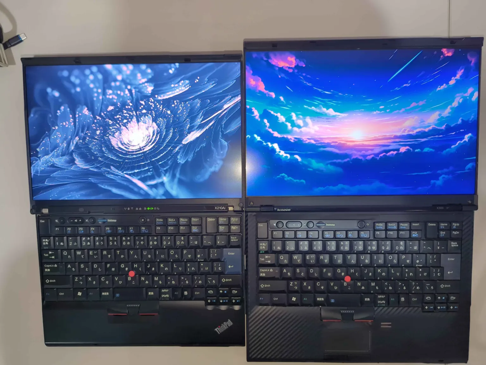

# X410Ai NixOS Config

Backup and reproducible config for my personal [NixOS](https://nixos.org) system, configured for a WIP "X410Ai" (ThinkPad [P14sG6](https://psref.lenovo.com/syspool/Sys/PDF/ThinkPad/ThinkPad_P14s_Gen_6_Intel/ThinkPad_P14s_Gen_6_Intel_Spec.pdf) in an [X300](https://www.thinkwiki.org/wiki/Category:X300).

